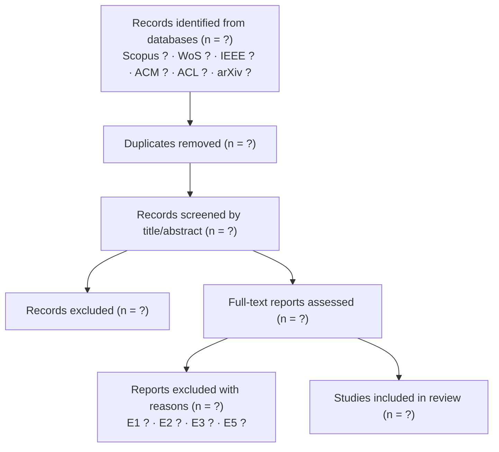

# Mini Systematic Literature Review — PRISMA 2020 (v0.1)

PhD in Deep Tech — UNMSM · Session 4 · Edgar Aldair Quispe Huaman

> Status: **review protocol only**. Searches have NOT been run yet. All counts are placeholders and must be filled with real numbers after the search.

## 1. Review question (PICO-style adapted to ML)

- **Population:** transformer-based foundation models (≈1B–13B parameters)
- **Intervention:** parameter-efficient fine-tuning combined with weight quantization (LoRA, QLoRA, AdaLoRA, DoRA, GPTQ/AWQ + adapters)
- **Comparison:** full fine-tuning or default PEFT configurations
- **Outcomes:** task quality, memory, latency, energy; **and** whether configuration is selected systematically under a compute budget
- **Question:** *How does the literature select quantization and adapter configurations under limited compute budgets, and what evidence exists on the resulting quality–cost trade-off?*

## 2. Sources

Scopus · Web of Science · IEEE Xplore · ACM Digital Library · arXiv (as grey literature, flagged separately) · ACL Anthology

## 3. Search strings (draft — adapt syntax per database)

```
( "low-rank adaptation" OR LoRA OR QLoRA OR "parameter-efficient fine-tuning" OR PEFT )
AND ( quantization OR quantized OR "4-bit" OR "8-bit" OR "low-bit" )
AND ( "large language model*" OR "foundation model*" OR "pre-trained language model*" OR transformer* )
AND ( memory OR "resource-constrained" OR "limited resources" OR efficiency OR budget OR "consumer GPU" OR edge )
```

Date range: 2019–2026 · Language: English and Spanish · Search date: ⏳ TODO (record exact date per database)

## 4. Eligibility criteria

**Include:**
- I1. Empirical study adapting a transformer model with PEFT and quantization
- I2. Reports at least one quality metric AND at least one cost metric (memory, latency, energy)
- I3. Peer-reviewed, or arXiv with ≥ N citations (⏳ define N)

**Exclude:**
- E1. Pre-training only (no adaptation)
- E2. Quantization of inference only, without adaptation
- E3. No quantitative evaluation
- E4. Surveys (kept for background, not included in synthesis)
- E5. Full text not available

## 5. PRISMA 2020 flow (fill with real counts)



## 6. Data extraction sheet

See [extraction_sheet.csv](extraction_sheet.csv). One row per included study.

## 7. Workflow

1. Run searches → export RIS/BibTeX → import into **Zotero** (one collection per database).
2. Deduplicate in Zotero → export to the screening sheet.
3. Title/abstract screening → full-text screening, recording exclusion reasons.
4. Extract data → synthesize → gap analysis.

## 8. Gap analysis (to complete after extraction)

| Dimension | What the literature covers | What is missing | My contribution |
|---|---|---|---|
| Configuration selection | ⏳ | ⏳ | Budget-aware selection method |
| Hardware | ⏳ | ⏳ | Limited / consumer-grade hardware |
| Language | ⏳ | ⏳ | Spanish-language tasks |
| Metrics | ⏳ | ⏳ | Energy as an outcome variable |
| Statistical rigor | ⏳ | ⏳ | Multiple seeds + tests (cf. Bean et al., 2025) |
