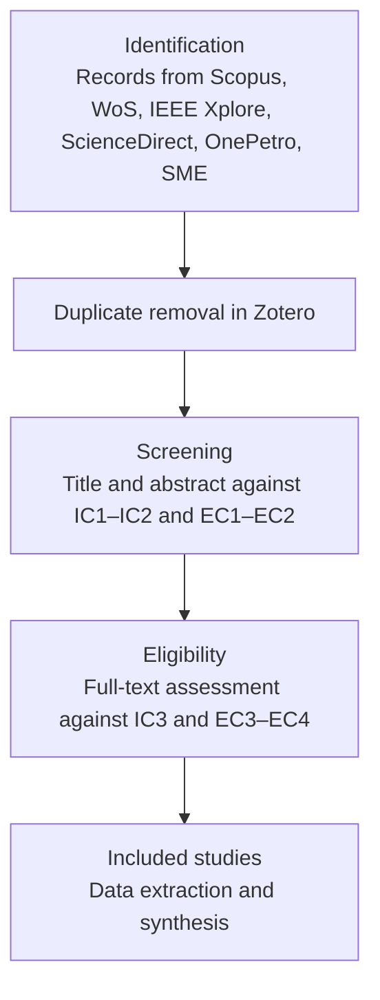

# Systematic Literature Review Protocol — PRISMA 2020 (v0.1)

PhD in Deep Tech · UNMSM · Session 4 · Edgar Aldair Quispe Huaman

## 1. Review Question

| Element | Definition |
|---|---|
| Population | Mobile extraction equipment in mining, with priority on underground loaders (LHD/scoops) and drilling jumbos |
| Intervention | Digital twins or AI agent-based systems for condition monitoring, fault detection, prognostics or maintenance planning |
| Comparison | Reactive, calendar-based or threshold-based maintenance and monitoring |
| Outcomes | Fault detection performance, prognostic error, availability, downtime, maintenance cost, and the connectivity and sensing assumptions of the twin |

**Question:** How have digital twins and AI agents been designed and evaluated for condition monitoring of mining equipment, and under which connectivity and sensing assumptions?

## 2. Information Sources

Scopus · Web of Science Core Collection · IEEE Xplore · ScienceDirect · OnePetro and SME Digital Library for mining engineering literature.

## 3. Search Blocks

- **Block A (Artifact):** digital twin, virtual twin, cyber-physical system, multi-agent system, intelligent agent.
- **Block B (Domain):** mining, underground mine, load-haul-dump, LHD, scoop, jumbo, mining equipment, haul truck.
- **Block C (Function):** condition monitoring, predictive maintenance, prognostics, remaining useful life, fault detection, anomaly detection, health management.
- **Block D (Constraint):** connectivity, wireless, edge, sparse data, telemetry, sensor.

## 4. Search Strings by Database (2017–2026)

**Scopus**

```
TITLE-ABS-KEY ( ( "digital twin*" OR "virtual twin*" OR "cyber-physical" OR "multi-agent" OR "intelligent agent*" )
AND ( mining OR "underground mine*" OR "load-haul-dump" OR lhd OR scoop* OR jumbo* OR "mining equipment" OR "haul truck*" )
AND ( "condition monitoring" OR "predictive maintenance" OR prognostic* OR "remaining useful life" OR "fault detection" OR "anomaly detection" OR "health management" ) )
AND PUBYEAR > 2016 AND PUBYEAR < 2027
AND ( LIMIT-TO ( DOCTYPE , "ar" ) OR LIMIT-TO ( DOCTYPE , "cp" ) )
```

**Web of Science**

```
TS=( ( "digital twin*" OR "virtual twin*" OR "cyber-physical" OR "multi-agent" OR "intelligent agent*" )
AND ( mining OR "underground mine*" OR "load-haul-dump" OR LHD OR scoop* OR jumbo* OR "mining equipment" OR "haul truck*" )
AND ( "condition monitoring" OR "predictive maintenance" OR prognostic* OR "remaining useful life" OR "fault detection" OR "anomaly detection" OR "health management" ) )
AND PY=(2017-2026) AND DT=(Article OR Proceedings Paper)
```

**IEEE Xplore**

```
("All Metadata":"digital twin" OR "All Metadata":"multi-agent")
AND ("All Metadata":mining OR "All Metadata":"underground mine" OR "All Metadata":"load-haul-dump")
AND ("All Metadata":"predictive maintenance" OR "All Metadata":"condition monitoring" OR "All Metadata":"fault detection")
```
Filter: 2017–2026, journals and conferences.

**ScienceDirect**

```
("digital twin" OR "multi-agent") AND (mining OR "underground mine" OR "load-haul-dump") AND ("predictive maintenance" OR "condition monitoring" OR prognostics)
```
Filter: 2017–2026, research articles.

**OnePetro / SME Digital Library:** "digital twin" AND ("underground" OR "LHD" OR "load-haul-dump") AND ("maintenance" OR "monitoring"), 2017–2026.

## 5. Eligibility Criteria

**Inclusion criteria (IC)**

- **IC1 (Temporal and peer review):** published 2017–2026 in peer-reviewed journals or proceedings.
- **IC2 (Artifact scope):** proposes, builds or evaluates a digital twin or agent-based system for monitoring or maintenance of mining equipment or comparable heavy mobile machinery.
- **IC3 (Transparency):** specifies the input data and at least one quantitative evaluation metric.

**Exclusion criteria (EC)**

- **EC1 (Out of domain):** mineral processing plants, geological modeling or mine planning without equipment condition monitoring.
- **EC2 (Non-empirical):** reviews, position papers or architectures without empirical or simulation-based evaluation; reviews are retained as background.
- **EC3 (Fixed infrastructure only):** stationary equipment with continuous wired connectivity, unless the method is transferable to mobile equipment.
- **EC4 (Full text unavailable).**

## 6. PRISMA 2020 Flow



## 7. Data Extraction

Each included study is coded by: equipment type, mining method (open-pit or underground), twin fidelity level (digital model, digital shadow, digital twin; Kritzinger et al., 2018), data sources and sensors, connectivity assumption, AI technique, role of agents, evaluation type (simulation, laboratory, field), baselines, metrics, human-in-the-loop design and key findings.

## 8. Reference Management

Records are exported from each database in RIS format into Zotero, one collection per source, deduplicated in Zotero and then screened in two stages with exclusion reasons recorded per record.

## 9. Gap Analysis

| Dimension | Established foundations | Gap the review must confirm | Contribution of this thesis |
|---|---|---|---|
| Twin synchronization | Twins defined by continuous data exchange between physical and virtual entities (Kritzinger et al., 2018; Tao et al., 2019) | Twins that operate under intermittent connectivity underground | Twin designed for intermittent data transmission |
| Equipment scope | Condition-based maintenance for rotating machinery and engines (Jardine et al., 2006; Saxena et al., 2008) | Twins specific to underground loaders and jumbos | Architecture focused on underground extraction equipment |
| Decision layer | Monitoring and prognostics as standalone models | Cooperating agents that connect detection with maintenance planning under crew constraints | Perception, diagnosis and planning agents |
| Evaluation | Prediction accuracy reported in isolation | Decision utility against maintenance baselines with paired replications | Paired evaluation against reactive and calendar-based policies |
| Context | Large operations with dense instrumentation | Mid-sized Peruvian operations with heterogeneous fleets | Design principles for partial telemetry |
