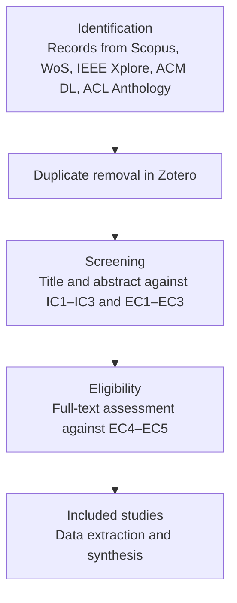

# Systematic Literature Review Protocol — PRISMA 2020 (v0.1)

PhD in Deep Tech · UNMSM · Session 4 · Edgar Aldair Quispe Huaman

## 1. Review Question

| Element | Definition |
|---|---|
| Population | Transformer-based foundation models between 1B and 13B parameters |
| Intervention | Parameter-efficient fine-tuning combined with weight quantization (LoRA, QLoRA, AdaLoRA, DoRA, GPTQ/AWQ with adapters) |
| Comparison | Full fine-tuning or default parameter-efficient configurations |
| Outcomes | Task quality, peak memory, latency, energy, and the criterion used to select the configuration |

**Question:** How does the literature select quantization and adapter configurations under limited compute budgets, and what evidence exists on the resulting quality–cost trade-off?

## 2. Information Sources

Scopus · Web of Science Core Collection · IEEE Xplore · ACM Digital Library · ACL Anthology. arXiv is searched as grey literature and reported separately.

## 3. Search Blocks

- **Block A (Adaptation):** low-rank adaptation, LoRA, QLoRA, parameter-efficient fine-tuning, PEFT, adapters.
- **Block B (Compression):** quantization, quantized, low-bit, 4-bit, 8-bit.
- **Block C (Model):** large language model, foundation model, pre-trained language model, transformer.
- **Block D (Constraint):** memory, resource-constrained, limited resources, budget, consumer GPU, edge, efficiency.

## 4. Search Strings by Database (2019–2026)

**Scopus**

```
TITLE-ABS-KEY ( ( "low-rank adaptation" OR lora OR qlora OR "parameter-efficient fine-tuning" OR peft OR adapter* )
AND ( quantiz* OR "low-bit" OR "4-bit" OR "8-bit" )
AND ( "large language model*" OR "foundation model*" OR "pre-trained language model*" OR transformer* )
AND ( memory OR "resource-constrained" OR "limited resource*" OR budget OR "consumer gpu" OR edge OR efficien* ) )
AND PUBYEAR > 2018 AND PUBYEAR < 2027
AND ( LIMIT-TO ( DOCTYPE , "ar" ) OR LIMIT-TO ( DOCTYPE , "cp" ) )
```

**Web of Science**

```
TS=( ( "low-rank adaptation" OR LoRA OR QLoRA OR "parameter-efficient fine-tuning" OR PEFT OR adapter* )
AND ( quantiz* OR "low-bit" OR "4-bit" OR "8-bit" )
AND ( "large language model*" OR "foundation model*" OR "pre-trained language model*" OR transformer* )
AND ( memory OR "resource-constrained" OR "limited resource*" OR budget OR "consumer GPU" OR edge OR efficien* ) )
AND PY=(2019-2026) AND DT=(Article OR Proceedings Paper)
```

**IEEE Xplore**

```
("All Metadata":"low-rank adaptation" OR "All Metadata":LoRA OR "All Metadata":QLoRA OR "All Metadata":"parameter-efficient fine-tuning")
AND ("All Metadata":quantiz* OR "All Metadata":"low-bit")
AND ("All Metadata":"large language model*" OR "All Metadata":transformer*)
AND ("All Metadata":memory OR "All Metadata":"resource-constrained" OR "All Metadata":efficien*)
```
Filter: 2019–2026, journals and conferences.

**ACM Digital Library**

```
[[Abstract: "low-rank adaptation"] OR [Abstract: lora] OR [Abstract: qlora] OR [Abstract: "parameter-efficient fine-tuning"]]
AND [[Abstract: quantiz*] OR [Abstract: "low-bit"]]
AND [[Abstract: "language model*"] OR [Abstract: transformer*]]
AND [Publication Date: (01/01/2019 TO 12/31/2026)]
```

**ACL Anthology:** full-text search for "QLoRA", "quantized LoRA" and "low-bit fine-tuning", 2019–2026.

## 5. Eligibility Criteria

**Inclusion criteria (IC)**

- **IC1 (Temporal and peer review):** published 2019–2026 in peer-reviewed journals or proceedings.
- **IC2 (Intervention):** adapts a transformer model using parameter-efficient fine-tuning together with quantization.
- **IC3 (Metric transparency):** reports at least one quality metric and at least one cost metric (memory, latency or energy).

**Exclusion criteria (EC)**

- **EC1 (Pre-training only):** no adaptation stage.
- **EC2 (Inference-only compression):** quantization without adaptation.
- **EC3 (Non-empirical):** surveys, position papers or proposals without quantitative evaluation; surveys are retained as background.
- **EC4 (Unreported configuration):** precision, rank or target modules not reported.
- **EC5 (Full text unavailable).**

## 6. PRISMA 2020 Flow



## 7. Data Extraction

Each included study is coded in [extraction_sheet.csv](extraction_sheet.csv): model family and size, adaptation method, quantization method and bits, ranks and target modules tested, hardware, tasks and language, quality and cost metrics reported, number of seeds, statistical test, configuration-selection criterion and key finding.

## 8. Reference Management

Records are exported from each database in RIS format into Zotero, one collection per source, deduplicated in Zotero and then screened in two stages with exclusion reasons recorded per record.

## 9. Gap Analysis

| Dimension | What the core literature covers | What is missing | Contribution of this thesis |
|---|---|---|---|
| Configuration selection | Fixed configurations chosen by the authors (Hu et al., 2022; Dettmers et al., 2023); dynamic rank allocation within a model (Zhang et al., 2023) | A selection criterion driven by an explicit memory budget (Ding et al., 2023; Mao et al., 2025) | Budget-aware selection method |
| Hardware | Validation on high-end data-center GPUs | Evidence on limited and consumer-grade hardware (Zhu et al., 2024) | Experiments on modest hardware |
| Language | Predominantly English benchmarks | Spanish-language tasks | Spanish tasks in both phases |
| Metrics | Quality and memory | Energy as an outcome variable (Schwartz et al., 2020) | Energy per unit of work |
| Statistical rigor | Single runs and point estimates | Multiple seeds and significance testing | Five seeds per configuration and paired tests |
