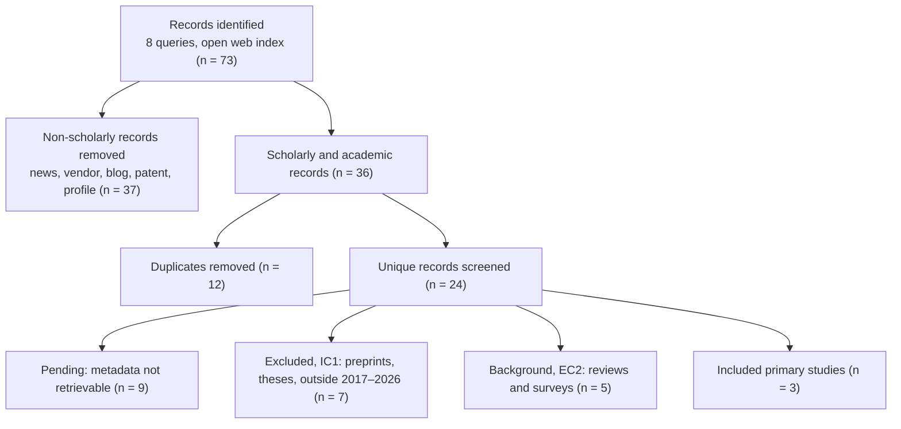

# Preliminary Search Run — PRISMA 2020 (25 October 2026)

PhD in Deep Tech · UNMSM · Session 4 · Edgar Aldair Quispe Huaman

## 1. Scope of This Run

A preliminary, open-index run executed to test the search blocks and anticipate the gap analysis before the full search in Scopus, Web of Science, IEEE Xplore, ScienceDirect, OnePetro and SME. Eight queries derived from the four search blocks were run on an open web index; every retrieved link is logged in [search_log.csv](search_log.csv) with its source type, decision and reason, and all 73 records, duplicates included, are listed in APA 7 format in [References_APA_73_records.md](References_APA_73_records.md).

| ID | Query | Blocks |
|---|---|---|
| Q1 | digital twin underground mining equipment LHD predictive maintenance | A + B + C |
| Q2 | digital twin mining equipment condition monitoring review 2023 2024 | A + B + C |
| Q3 | load-haul-dump machine fault detection machine learning underground mine sensor data | B + C + D |
| Q4 | multi-agent system predictive maintenance mining digital twin | A + B + C |
| Q5 | underground mine wireless connectivity intermittent data equipment telemetry digital twin | A + B + D |
| Q6 | remaining useful life prediction mining haul truck LHD deep learning | B + C |
| Q7 | scooptram LHD condition monitoring anomaly detection telemetry underground mine paper | B + C + D |
| Q8 | digital twin minería subterránea Perú mantenimiento predictivo equipos | A + B + C |

## 2. PRISMA 2020 Flow of the Preliminary Run

## 3. Records Retained

| Key | Reference | Decision |
|---|---|---|
| qi2023 | Qi, Z., Gu, Q., Meng, Y., Bai, G., & Ding, D. (2023). The load-haul-dump operation cycle recognition based on multi-sensor feature selection and bidirectional long short-term memory network. *Measurement and Control, 56*(9–10), 1523–1533. https://doi.org/10.1177/00202940231161569 | Included |
| skoczylas2023 | Skoczylas, A., Rot, A., Stefaniak, P., & Śliwiński, P. (2023). Haulage cycles identification for wheeled transport in underground mine using neural networks. *Sensors, 23*(3), 1331. https://doi.org/10.3390/s23031331 | Included |
| ma2025 | Ma, Z., Tang, M., Dai, L., Wu, X., Wang, T., & Wang, D. (2025). Remaining useful life prediction of mining equipment based on wavelet thresholding and ResNet. *Traitement du Signal, 42*(2), 761–770. https://doi.org/10.18280/ts.420214 | Included |
| rojas2025 | Rojas, L., Peña, Á., & Garcia, J. (2025). AI-driven predictive maintenance in mining: A systematic literature review on fault detection, digital twins, and intelligent asset management. *Applied Sciences, 15*(6), 3337. https://doi.org/10.3390/app15063337 | Background |
| mamani2025 | Mamani López, H. Y., Neyra Enciso, A. N., & Canahua Apaza, N. M. (2025). Integrating machine learning and digital twin to improve plant equipment efficiency in the mining sector: A systematic review. *LEIRD 2025, LACCEI*. https://doi.org/10.18687/LEIRD2025.1.1.775 | Background |
| gkzdh2024 | Research progress on digital twin technology for intelligent mines (2024). *Industry and Mine Automation (Gong-kuang zidonghua)*. | Background |
| vandinter2022 | Predictive maintenance using digital twins: A systematic literature review (2022), 42 primary studies. | Background |
| pmc11174398 | Remaining useful life prediction based on deep learning: A survey (PMC11174398). | Background |

## 4. Preliminary Findings for the Gap Analysis

1. **Fixed plant dominates.** The most recent systematic review on AI-driven predictive maintenance in mining (Rojas et al., 2025; 166 studies from Scopus and Web of Science) reports applications concentrated on crushers, conveyor belts, mills and ventilation systems. A second PRISMA review (Mamani López et al., 2025; 74 articles, 2019–2025) addresses plant equipment such as flotation, conveying and mills. Underground mobile equipment is not the focus of either review.
2. **Connectivity is an open dimension.** The 2024 review of digital twins for intelligent mines identifies connectivity among the five dimensions with open challenges, alongside physical entities, virtual models, twin data and services.
3. **LHD data exist but serve operations.** The included LHD studies (Qi et al., 2023; Skoczylas et al., 2023) use on-board multi-sensor data to recognize haulage cycles, not to monitor condition or plan maintenance.
4. **Prognostics without a decision layer.** Ma et al. (2025) predict remaining useful life of mining equipment from vibration signals, without a twin or a maintenance-planning component.
5. **Peruvian context.** Digital twin initiatives reported in Peruvian mining media concern open-pit operations and mineral processing rather than underground extraction equipment; these sources are non-scholarly and serve only as context.

## 5. Limitations of This Run

The run used an open web index, not the licensed databases of the protocol; result ranking is not reproducible in the way database queries are, and nine scholarly records could not be screened because their metadata were not retrievable. Counts in this run are therefore preliminary and will be replaced by the full database search.
