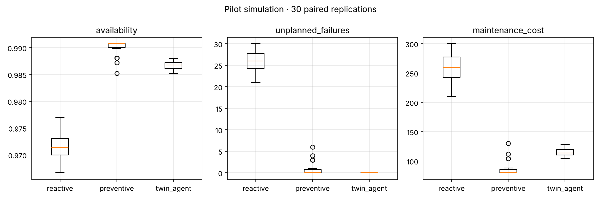

# 05_Reproducible_ML_Pipeline

Banco de pruebas reproducible del gemelo digital: simula una flota de cargadores LHD (scoops) en mina subterránea con degradación estocástica, ciclos de trabajo, ruido de sensores y conectividad intermitente, y compara tres políticas de mantenimiento sobre las mismas trayectorias.

## Políticas comparadas

| Política | Descripción |
|---|---|
| reactive | Reparación correctiva tras la falla (24 h fuera de servicio). |
| preventive | Mantenimiento preventivo por calendario cada 450 h de operación (6 h fuera de servicio). |
| twin_agent | Gemelo digital con agentes: el agente de diagnóstico calcula la distancia de Mahalanobis a la línea base saludable con suavizado exponencial; el agente de planificación prioriza las unidades en alarma respetando la capacidad de la cuadrilla. |

## Diseño experimental

- **Unidad de análisis:** una réplica de la flota bajo una política.
- **Números aleatorios comunes:** las tres políticas se evalúan sobre las mismas trayectorias de degradación, carga, ruido y conectividad.
- **Réplicas:** 30 réplicas pareadas, 10 equipos, 2 160 horas (90 días).
- **Análisis:** media, desviación estándar e IC bootstrap al 95%; prueba de Wilcoxon pareada, tamaño del efecto rank-biserial y corrección de Holm.

## Estructura

```
05_Reproducible_ML_Pipeline/
├── configs/pilot.yaml
├── src/
│   ├── simulator.py
│   ├── run_experiment.py
│   └── analyze.py
├── results/
└── requirements.txt
```

## Ejecución

```bash
pip install -r requirements.txt
python src/run_experiment.py --config configs/pilot.yaml
python src/analyze.py --experiment pilot_lhd_fleet
python src/run_experiment.py --config configs/pilot.yaml --set connectivity.p_connected=0.3 experiment=conn_030
```

## Resultados del piloto

| Política | Disponibilidad | Fallas no planificadas | Intervenciones preventivas | Costo de mantenimiento |
|---|---|---|---|---|
| reactive | 0.972 | 25.83 | 0.00 | 258.3 |
| preventive | 0.990 | 0.73 | 39.30 | 85.9 |
| twin_agent | 0.987 | 0.00 | 57.67 | 115.3 |

Comparaciones pareadas (30 réplicas, Holm):

- **twin_agent vs reactive:** +0.015 de disponibilidad, −25.8 fallas y −143.0 de costo (p < 0.001 en las tres métricas).
- **twin_agent vs preventive:** −0.73 fallas (p ajustado = 0.033), pero −0.003 de disponibilidad y +29.4 de costo (p < 0.001).

El gemelo elimina las fallas no planificadas, pero interviene antes de lo necesario; la calibración del umbral de alarma es la siguiente iteración de diseño.


